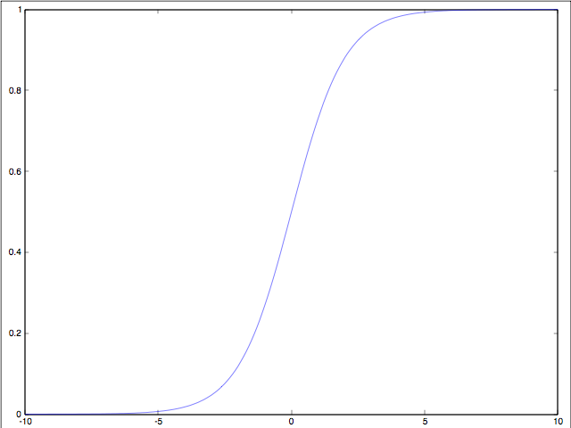

# Gradient Descent For Logistic Regression

I was binge watching (no kidding) all videos from Andrew Ng's Coursera ML class. May be I want to write a review at a certain point. In short, it is highly recommendable for anyone who works in data science and machine learning to go through the class and spend some time to finish the homework step-by-step.

What I want to talk about though is an interesting mathematical equation you can find in the lecture, namely the gradient descent update or logistic regression. You might notice that gradient descents for both linear regression and logistic regression have the same form in terms of the hypothesis function. i.e.

$\theta_j := \theta_{j} - \alpha \sum_{i=1}^M (H_{\theta} (\pmb{x}^{(i)}) - y^{(i)}) x_j^{(i)}......(1)$

Notation can be found in [Prof. Ng's lecture at Coursera](https://www.coursera.org/learn/machine-learning). Also you can find the lecture notes at [here](http://www.holehouse.org/mlclass/06_Logistic_Regression.html).

So why is it the case then? In a nutshell, it has to do with how the cost function $\\latex J(\\theta)$ was constructed. But let us back up and do some simple Calculus exercises on how the update equation can be derived.

In general, updating the parameter $\theta_j$ with gradient descent follows

$\theta_j := \theta_{j} - \alpha \frac{\partial J(\theta)} {\partial \theta}......(2)$

So we first consider linear regression with hypothesis function,

$H_{\theta}(\pmb{x}) = \theta^T \pmb{x}......(3)$

and cost function,

$J(\theta) = \frac{1}{2}\sum_{i=1}^M (H_{\theta}(\pmb{x}^{(i)})- y^{(i)})^2......(4)$.

So....

$\frac{\partial J(\theta)}{\partial \theta_j} = \frac{\partial J(\theta)}{\partial H_{\theta}(\pmb{x}^{(i)})} \frac{\partial H_{\theta}(\pmb{x}^{(i)})}{\partial \theta_j}$

$= \sum_{i=1}^M (H_{\theta} (\pmb{x}^{(i)}) - y^{(i)}) x_j^{(i)} for k = 1 \ldots N$

So we arrive update equation (1).

Before we go on notice that in our derivation for linear regression, we use chain rule to simplify. Many of these super long expressions can be simplified much more easily if you happen to know the trick.

So how about logistic regression? The hypothesis function of logistic regression is $H_{\theta}(\pmb{x}) = g(\theta^T \pmb{x})......(5)$

where $g(z)$ is the sigmoid function$

$g(z) = \frac{1}{1+e^{-z}}...... (6)$.

as we can plot in Diagram 1.

Diagram 1: A sigmoid function

Sigmoid function is widely used in engineering and science. For our discussion, here's one very useful property:

$\frac{dg(z)}{dz} = g(z) (1 - g(z)) ...... (7)$

Proof: $\frac{dg(z)}{dz} = \frac{d}{dz}\frac{1}{1+e^{-z}}$ $= -(\frac{-e^{-z}}{(1+e^{-z})^2})$ $= \frac{e^{-z}}{(1+e^{-z})^2}$ $= g(z)(1-g(z))$

as $1-g(z) = \frac{e^{-z}}{1+e^{-z}}$.

Now we have all the tools, let's go forward to calculate the gradient term for the logistic regression cost function, which is defined as,

$J(\theta) = \sum_{i=1}^M \lbrack -y^{(i)}log H_{\theta}(x^{(i)})-(1-y^{(i)})log (1- H_\theta(x^{i}))\rbrack$

The gradient is

$\frac{\partial J(\theta)}{\partial\theta_k} = \sum_{i=1}^M \lbrack -y^{(i)} \frac{H'_{\theta}(x^{(i)})}{H_{\theta}(x^{(i)})} + (1- y^{(i)}) \frac{H'_{\theta}(x^{(i)})}{1-H_{\theta}(x^{(i)})}\rbrack ......(8)$

So making use of Equation (7) and chain rule, the gradient w.r.t $\theta_k$:

$H'_{\theta}(x^{(i)}) = H_{\theta}(x^{(i)})(1-H_{\theta}(x^{(i)}))x_k^{(i)} .....(9)$

Substitute (9) into (8),

$\frac{\partial J(\theta)}{\partial\theta_k} = \sum_{i=1}^M -y^{(i)}\frac{H_{\theta}(x^{(i)})(1-H_{\theta}(x^{(i)}))x_k^{(i)} }{H_{\theta}(x^{(i)})} + \sum_{i=1}^M (1- y^{(i)}) \frac{H_{\theta}(x^{(i)})(1-H_{\theta}(x^{(i)}))x_k^{(i)} }{1-H_{\theta}(x^{(i)})}$ $= \sum_{i=1}^M\lbrack -y^{(i)} (1-H_{\theta}(x^{(i)}))x_k^{(i)} \rbrack + \sum_{i=1}^M\lbrack (1- y^{(i)}) H_{\theta}(x^{(i)})x_k^{(i)} \rbrack$ $= x_k^{(i)} \lbrack \sum_{i=1}^M (-y^{(i)} + y^{(i)} H_{\theta}(x^{(i)}) + \sum_{i=1}^M (H_{\theta}(x^{(i)}) - y^{(i)} H_{\theta}(x^{(i)})) \rbrack$

As you may observed, the second and the fourth term cancel out. So we end up having:

$\frac{\partial J(\theta)}{\partial\theta_k} = \sum_{i=1}^M (H_{\theta}(x^{(i)}) -y^{(i)})x_k^{(i)}$,

which brings us back update rule (2).

This little calculus exercise shows that both linear regression and logistic regression (actually a kind of classification) arrive the same update rule. What we should appreciate is that the design of the cost function is part of the reasons why such "coincidence" happens. But that's why I appreciate Ng's simple lecture. It is using a set of derivation which brings beginners into machine learning more easily.

Arthur

Reference: Profession Ng's lectures : https://www.coursera.org/learn/machine-learning

Property of sigmoid function can be found at Wikipedia page: https://en.wikipedia.org/wiki/Sigmoid_function

Many linear separator-based machine learning algorithms can be trained using simple gradient descent. Take a look of Chapter 5 of Duda, Hart and Stork's[Pattern Classification](http://www.amazon.com/Pattern-Classification-Pt-1-Richard-Duda/dp/0471056693/ref=sr_1_1?ie=UTF8&qid=1440029629&sr=8-1&keywords=duda+and+hart).

---

## Comments

**Rohan** (2017-10-31):

Nice article.

In equation 8, what is H'

> **grandjanitor** (2017-11-01):
>
> It's just derivative of H w.r.t. to theta.

