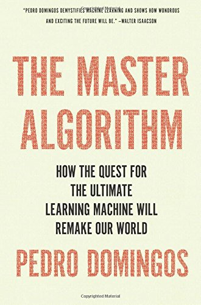

# One Algorithm to rule them all - Reading "The Master Algorithm"

I read a lot of sci non-fi, and I always wonder why there is no popular account of machine learning, especially given it is so prevalent in our time. Machine learners are everywhere: when you use Siri, when we search the web, when we translate using service such as Google translate, when we use email and spam filter helps us to remove most of the junks.

Prof. Pedro Domingos' book, [The Master Algorithm](http://www.amazon.com/Master-Algorithm-Ultimate-Learning-Machine/dp/0465065708/ref=sr_1_1?ie=UTF8&qid=1450060448&sr=8-1&keywords=pedro+domingos) (TMA), is perhaps the first popular account of machine learning (I know of). I greatly enjoy the book. The book is most suitable for high school or first-year college students who want to learn more about machine learning. But experienced practitioners (like me) would enjoy many ideas from the book. 

# Target Audience

Let's ignore forgettable books with title such as "Would MACHINES become SKYNET?" or "Are ROBOTS TAKING OVER THE WORLD?" type of fluffiest fluff. Most books I know on introductory level of machine learning are specialized on one type of technique with titles such as "Machine Learning Technique X Without Pain", etc. They are more a kind of user manual. In my view, they also lean on the practical side of thing too much. Those are good for *tasting* machine learning*,* but they seldom give you more understanding of what you are doing.

On the other hand, comprehensive textbooks in the field such as Mitchell's [Machine Learning](http://www.amazon.com/Machine-Learning-Tom-M-Mitchell/dp/0070428077/ref=sr_1_16?ie=UTF8&qid=1450061621&sr=8-16&keywords=machine+learning) or Bishop's [Pattern Recognition and Machine Learning](http://www.amazon.com/Pattern-Recognition-Machine-Learning-1st/dp/8132209060/ref=sr_1_1?ie=UTF8&qid=1450061716&sr=8-1&keywords=bishops+pattern+recognition) (also known as PRML), Hastie's [The Element of Statistical Learning](http://www.amazon.com/The-Elements-Statistical-Learning-Prediction/dp/0387848576/ref=pd_sim_14_3?ie=UTF8&dpID=41LeU3HcBdL&dpSrc=sims&preST=_AC_UL160_SR103%2C160_&refRID=0PX21F6RG928M50HKKG8) and of course Duda and Hart's [Pattern Classification](http://www.amazon.com/Pattern-Classification-2nd-Computer-Manual/dp/0471703508/ref=sr_1_fkmr0_2?ie=UTF8&qid=1450061927&sr=8-2-fkmr0&keywords=duda+and+hard+pattern+recognition) (2rd), are more for practitioners who want to deepen their understanding[1]. Out of the four books I just mentioned, perhaps *Machine Learning* is the most readable, but it still requires prerequisite knowledge such as multivariate calculus and familarity of Bayes' Rules. PRML would challenge you with (more) advanced tricks of calculus such as how to work with tricky integrals such as $\int_{-\infty}^{\infty} e^{-x^2} dx$ or gamma functions. They are hardly for the general reader whom does not have much sophistication in math.

I think TMA ** fills in the gap between a user manual and a comprehensive textbook. Most explanation are in words, or perhaps college level of math. Yet the coverage is very similar to *Machine Learning.*  It is still dumbed down but touch many goodies (and toughies) in machine learning such as No Free Lunch Theorem. 

# 5 Schools of Machine Learning

In TMA, Prof. Domingos divides existing machine learning techniques into 5 schools:

1, *Symbolist* : such as logic-based representation, rule-based approach,

2, *Connectionist : such as* neural networks,

3, *Evolutionist: such as* genetic algorithms,

4, *Bayesian: bayesian network,*

5, *Analogizer:*  nearest neighborhood, linear separators, SVM.

To be frank, the scheme can be hard to use in practice..... Most modern textbook such as PRML or Duda and Hart usually discuss Bayesian approach but mixed with techniques in the other 4 categories. I guess the reason is you can always have some Bayesian interpretation of a parameter estimation technique.

Artificial neural network (NN) is another example, which can have multiple categories in the TMA's scheme. It's true, ANN was motivated by human neural network (HNN). But ANN's formulation is quite different from computational models from HNN. So one way to think about ANN is "a stacks of logistic regressor". [2]

Even though I think the TMA's scheme of dividing algorithms is weird, as a popular book, I think this treatment is fair. In a way, you can say it's also hard to find a consistent scheme to classify machine learning algorithm. If you ask me, I will say "Woa, you should totally learn linear regression, logistic regression ....." and come up with 8 techniques. But that, just like many textbooks, are not easy to comprehend by general readers.

I guess more importantly, you should ask if the *coverage* is good. Most practitioners of ML are perhaps specialists like me (on ASR) or particular subfields. It's easy to get tunnel vision on what can be done and researched. 

# "The Master Algorithm"

So what is the eponymous "Master Algorithm" then? The Professor explained in p.24, which he calls the *central thesis* of the book. 

> *"All knowledge - past, present, and future - can be derived from data by a single universal learning algorithm."*

Prof. Domingo then motivates why he has such belief and I think this also highlights the thinking of latest research in Machine Learning. What do I mean by that?

Well, you can think of in machine learning work in real life are just testing different techniques and see if they work well. For example, my recent word sense disambiguation homework recommends me to try out both SVM and kNN. (We then saw the miraculous power of SVM......) But that's the deal, most of the time, you use the best technique through evaluation.

But in the last 5-6 years, we witness that deep neural network (and its friends, RNN, CNN etc) becomes the winners of competitions in many fields. Not only ASR [3], computer vision [4], we are seeing NLP's record is beat by neural network [5]. That thus make you think. Would one algorithm can rule it all?

And another frequently talk-about discovery is about human neocortex. If you know the popular view of neuroscience. Most of our brain's function are localized. i.e. For vision, there is a region called visual cortex, for sound, there is a region called audio cortex.

Then you might heard of amazing experiment that when researcher tried to wire the connection from the eyes, to the audio cortex. It is possible that the audio cortex would learn how to see. That is a sign that neocortex circuitry can be reused [6] for many different purposes.

I think that's what Prof. Domingos is driving at. In the book, he also tries to motivated from other perspectives. But I think the neuro-scientific perspective probably resonates our time the most. 

# No Deep Learning

While I like TMA's general coverage, I would hope that there are some descriptions on deep learning, which as I said in last paragraph, has been beating records here and there.

But then we should feel alarmed. Yes, right now deep learning is showing superior results. But so did SVM (even now) or GMM. It just means that our search of the best algorithm is still on-going and might never end. That's perhaps the good professor is not too focused on deep learning. 

# Conclusion

While I comment on the applicability of the "5 schools" categorization scheme, I love the books' comprehensive coverage and its central thesis. The book is also good for wide audience: for high-school and college students who heard of machine learning first time, this book is a good introductory book. While for specialists like me, this book can inspire new ideas and help consolidate the old ones. e.g. This is the first time I read about performance of nearest neighbor is only twice as error prone as the best imaginable classifier (p.185).

So I highly recommend this book for anyone who is interested in machine learning. Of course, feel free to tell me what you think in the comment section. 

# References:

[1] The other classic I missed here is Prof. Kevin Murphy's *Machine Learning - a Probabilist Perspective.*

[2] I heard this from [Dr. Richard Socher's DNN+NLP class](http://cs224d.stanford.edu/).

[3] G. Hinton et al. [Deep Neural Networks for Acoustic Modeling in Speech Recognition](http://static.googleusercontent.com/media/research.google.com/en//pubs/archive/38131.pdf).

[4] Alexnet: [paper](http://papers.nips.cc/paper/4824-imagenet-classification-with-deep-convolutional-neural-networks.pdf).

[5] I.Sutskever et al *[Sequence to Sequence Learning with Neural NetworksI am thinking more on the line of SMT](http://arxiv.org/pdf/1409.3215v3.pdf)*. Latest I heard: with attention model and some tuning. NN-based SMT beats traditional IBM Models-based approach.

[6] In TMA, this [paper](http://www.nature.com/nature/journal/v404/n6780/full/404871a0.html) on ferret is quoted.
