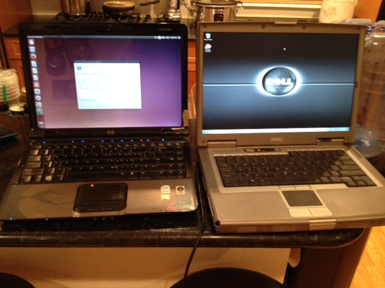

# Me and My Machines

I wrote a page long time ago [about the machines I used](http://www.cs.cmu.edu/~archan/personal/personal.html). When you work with computing for a while, every one of your computers mean something to you. That's why I tried not to throw them away easily. Occasionally I also bought scrape computers, fixed them up and felt like I did a good thing for the planet.

Anyway, here is a list of machine I used. Some with more stories than the others: 
1. **A 286 (1991-1992?) :** The first computer I ever touch back in junior high school. There was a geeky senior dude tried to teach us the basic of database and none of us really understand him. He wasn't nice to us, who were like 12-13 years old. I disliked his attitude and called him out. He was so unhappy and stormed out the computer room. We eventually learn stuffs like LOGO, and basic DOS commands on these very slow 286. (Well, you can optimize the hell of them though.)
2. **A 486-66DX (1994-1996?)**: My first computer and I had it since high school. I wasn't very into computer at that time. I used it to play Tie-Fighter, and wrote documents using Words. I also did several assignments on microprocessor programming (i.e. basic Assembly stuffs). It was incredibly slow and it takes a long time to compile a Visual C++ backbone windows program. Later, I gave it to a girl and she just threw the whole thing away. (Shame on me. I threw away a relic of computer history.)
3. **A P166 "Mars" (1996-2000):** I bought this when I am second year in College. Since I spent most of my money on this machine, I was doing part-time during my degree. And I was finally able to do some interesting stuffs on computer such as GUI programming. The GUI programming stuffs makes me get a good contract from librarian who tries to develop cataloging software. I also wrote my first isolated word speech recognizer on it. Later I ran a speech recognizer written by a guy named Ricky Chan. The recognizer was then used in my final year project. Unfortunately, both the cataloging software and my final year project were disasters: I didn't know how to fix memory leaks in C/C++ at that point. All my programs died horribly. Good Ricky Chan has nothing to do with it. **It's all my fault.** But, the horror of Windows 95's blue screen still haunt me even these days. Of course, both the librarian and my then-boss saw me at very dim light. (They probably still do.) I was cleaning my basement this year and Mars was getting too dirty. So I painfully threw it away with tears in my eyes.
4. **A P500 "Jupiter" (2000-):** I bought this in my first year of graduate school, half a year after I started to receive stipends. This is the moment I was very into HTK (Hidden Markov Toolkit). I still kept Mars, but if you want to train HMM for connected digit recognition using TIDIGITS, my P166 with 16Mb will take me close to a week. My P500 though allows me to run TIMIT and I was even able to train triphones (Woo!) . I also gleefully run every steps from the HTK manual V2.2 even though I had no idea what I was doing. Jupiter was also the machine I wrote the modified Viterbi algorithm in my thesis (formally Frame-Skipping Viterbi Algorithm (FSVA)). I still keep the mid-frame body of the "Jupiter" but I think it wasn't working well since around 6 years ago.
5. **A Book Mini-PC (2000):** In between Mars and Jupiter, I bought a mini-form PC. I tried to install Red Hat Linux on it, but I was very bad at any Linux installation then. Eventually the mother board was burned and I gave it to my friend who claim to know how to fix motherboard. (He never got back to me.)
6. **"eea045" (2000-2003)**: It is a lab machine I used back in HKUST, it was first a Pentium 500MHz, but soon my boss upgraded it to 1.7GHz. I was jubilant to use it to run acoustic model training, I also ran most of my theses' experiments on it.
7. **A Toshiba laptop (2002)** My mom gave it to me because she said it's not running too well. It dies on me right at the day I was going to present my Master Thesis. Luckily, someone helps me to borrow a machine from the EEE department so now I am a happy Master.
8. **"Snoopy" (2001-2003):** I was then a Junior Speech Scientist at Speechworks. And this Pentium 500 was assigned to me. It is also the first of the four machines I used with funny names.
9. "**Grandpa" (2001-2003):** The laptop assigned to me in Speechworks. It solved a lot of funny crises for me. I really missed "Grandpa" when I was laid off from Speechworks.
10. **iBuddie 4 A928 (2002-2003):** A thing called desknote at the time, it's like a laptop but you always have to give it juice. Again, its motherboard burnt. And again, I don't quite know how to fix it.
11. **"Lumpy" (2003-2006):** This is the machine assigned to me from CMU SCS, and I asked the admin many times if the name is some kind of very profound joke. "No" is their answer. But I always know it's a setup. :| Always know.
12. **"Grumpy"/"Big Baby" (2003-)**: This is a Dell Inspiron 9100 I bought in a hefty price of $3000. Even at 2004, it was a heavy laptop. I used it for most of my CMU work, including hacking Sphinx, writing papers. Prof. Alex Rudnicky, my then-boss in CMU, always jokingly asked me if Big Baby is a dock station. (Seriously, No.) I also used it as my temporary laptop in Scanscout. The laptop is so large and heavy, I used it as my dumbbells in Scanscout.
13. **"The Cartoon Network"(2003-2006):** This is the name of cluster in CMU Sphinx Group which is used by many students from the Robust Group, by me and David Huggins Daines, Alex's student, as well as Evandro, who was then working for Prof. Jack Mostow. The names of the machines were all based on cartoon characters from Cartoon networks: for example, Blossoms, Bubbles and Buttercups are three 2G Hz machines which were not too reliable. I have been asking Alex to name one of the machines to be [Mojo Jojo](https://en.wikipedia.org/wiki/List_of_The_Powerpuff_Girls_characters#Mojo_Jojo). But he keeps on refusing me. (Why? Why Alex?)
14. **A G4 (2004-2006)** This is the first Mac I ever used in my life but it's one of the most important. I used it to develop for a project called CALO (Cognitive Agent that Learn and Organize), now venerable because several SRI participants started an engine which nowadays called Siri. But what I learned is simpler: Apple would grow big, since then I invested on Apple regularly, with reasonable profit.
15. **A Lenovo laptop (2007-2008):**  In my short stay at Scanscout, I used this machine exclusively to compile and develop what then called the SSFramework **("**ScanScout Framework"), a java-Tomcat stack which Scanscout used to serve video ad. I ghosted it to have two partitions: Windows and Linux. I mostly worked on Windows. At that point, I always have small issues here and there to switch back to Linux. Usually, the very versatile tech guru Dr. Tadashi Yonezaki would help me. Dr. Yonezaki later became the Chief Scientist of Scanscout.
16. **"Scanscouts' Machines" (2007-2008):** I can't quite remember how the setting is, but all machines from early Scanscouts were shared by core technology scientists, like Tadashi or me, and several developers, QAs. I wasn't too into "The Scout" (how couple of early Alumi called it). So I left the company after only 1.5 years. A good ending though: Scanscout was later acquired by Tremor Video and got listed.
17. **Inspiron 530 "Inspirie" (2008 - ):** There was around half a year of time when I resigned from Scanscout, I was unemployed. I stayed home most of the time, read a lot and played tons of poker and backgammon on-line. That was also the time I bought Inspirie. For long time, it wasn't doing much other than being a home media center. Last few years though, Inspirie played an important role as I tried to learn deep learning. I ran all Theano's tutorial on it (despite it being very very slow).
18. **Machines I used in a S&P 500 company (2009-2011):** Between "The Scout" and Voci, I was hired by a mid-size research institute as a Staff Scientist, and took care much of the experimental work within the group. It's a tough job, has long hours and so my mind usually get very numb. I can only vaguely remember there are around 3 incidences of my terminal were broken. That was also the time I was routinely using around 200 to 300 cores, which my guess is around 10-15% of all cores available within the department. I was always told to tone down usage. Since there are couple of guys in the department were exactly like me, recklessly sending jobs to the queue, the admin decides to have a scheme which limit the amount of cores we could use.
19. **A 2011 Macbook Pro 17 inches "Macky" (2011** -**)**  After several years of saving, I finally bought my first Macbook. I LOVE IT SO MUCH! It was also the first time since many years I feel computing is *fun.*  I wrote several blogs, several little games with Macky but mostly it was the machine I carried around. Unfortunately, a horrible person poured tea on top of it. So its display was permanently broken, I have to connect it with an LCD all the time. But it is still the machine I love most. Because it makes me *love computing again*.
20. **"IBM P2.8 4 cores" (2011-)** A machine assigned to me by Voci. Most of my recent work on the Voci's speech recognition framework was done on it.
21. **"Machines from Voci" (2011-)** They are fun machines. Part of it is due to the rise of GPUs. Unfortunately I can't talk about theirs settings too much. Let's say Voci has been doing great work with them.
22. **"A 13 inches MacBook" (2014-)** This is my current laptop. I took most of my Cousera classes with it. I feel great about its size and easy-goingness.
23. "**An HP Stream" (2015-)** My current Windows machine. I hate Windows but you got to use it sometimes. A $200 price tag seems about right.
24. "**Dell M70" and "HP Pavilion dv2000" (2015-)** i.e. The machine you saw in the image up top of this post. I bought each of them for less than $10 from Goodwill. Both of them have no problem in operation, but small physical issues such as dent and broken hinges. A screwdriver and some electric tape would fix them easily.

There you have it. The 24 sets of machines I have touched. Mostly a history of story of some unknown silicons, but also my personal perspective on computing.

Arthur

(Edit at Dec 24: Fixed some typos.)
