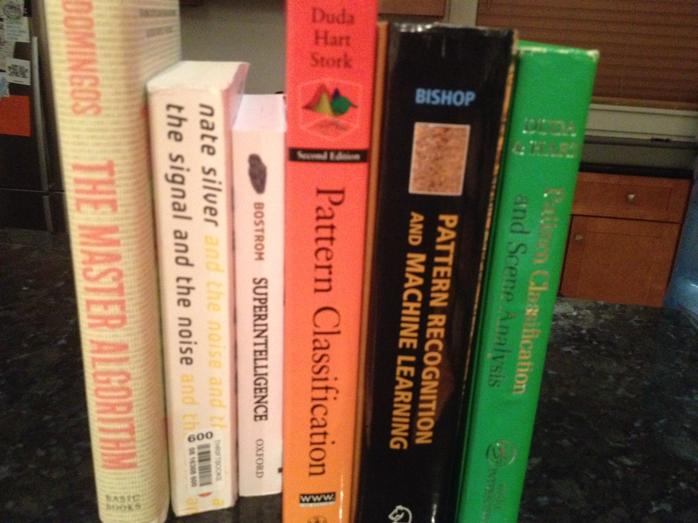

# (Repost) Recommended books in Machine Learning/Deep Learning.

(I am editing my site, so I decide to separate the book list into a separate page.)

I am often asked what the best beginner books on machine learning. Here I list several notable references and they are usually known as "Bibles" in the field. Also read the comments on why they are useful and how you may read them. 

# Machine Learning:

### [Pattern Recognition and Machine Learning ](https://www.amazon.com/Pattern-Recognition-Learning-Information-Statistics/dp/0387310738)by Christopher Bishop

One of the most popular and useful references in general machine learning. It is also the tougher book to read among this list. Generally known as PRML, *Pattern Recognition and Machine Learning* is a comprehensive treatment on several important and relevant machine learning techniques such as neural networks, graphical models and boosting. There are in-depth discussion as well as supplementary exercises on each techniques.

The book is very Bayesian, and rightly so because Bayesian thinking is very useful in practice. e.g. It's treatment of bias-variance is to treat it as the "frequentist illusion", which is a more advanced view point compared to most beginner classes you would take. (I think only Hinton's class fairly discuss the merit of Bayesian approach.)

While it is a huge tomb, I would still consider the book as a beginner book, because it doesn't really touch all important issues in all techniques. e.g. there is no in-depth discussion in sequential minimal optimization (SMO) in SVM. It is also not a deep learning /deep neural network book. For that Bengio/GoodFellow's book seem to be a much better read.

If you want to reap benefit out of this book, consider to do exercise from the back of the books. Sure it will take you a while, but *doing any one of the exercises would give you incredible insight* on how different machine techniques work. 

### [Pattern Classification](https://www.amazon.com/Pattern-Classification-Pt-1-Richard-Duda/dp/0471056693/ref=sr_1_1?s=books&ie=UTF8&qid=1470185816&sr=1-1&keywords=duda+and+hart) 3rd Edition by R. Duda, P.E. Hart and D.G Stork

Commonly known as "Duda and Hart", its 2nd Edition titled "Pattern Classification and Scene Analysis" was more known to be bible of pattern classification. Of course, nowadays "machine learning" is the more trendy term, and in my view the two topics are quite similar.

The book is highly technical (and perhaps terse) description of machine learning, which I found more senior scientists usually referred to back when I was working at Raytheon BBN.

Compare to PRML, I found that "Duda and Hart" is slightly outdated, but it's treatment on linear classifiers is still very illuminating. The 3rd edition is updated so that there are computer exercises. Since I usually learn an algorithm directly looking at either the original paper or source code, I found these exercises are not as useful. But some of my first mathematical drilling (back in 2000s) on pattern recognition does come from the guided exercises of this book, so I still recommend this book to beginners. 

### [Machine Learning](https://www.amazon.com/Machine-Learning-Tom-M-Mitchell/dp/0070428077/ref=sr_1_1?s=books&ie=UTF8&qid=1470186644&sr=1-1&keywords=machine+learning+tom+mitchell) by Tom Mitchell

Compared to PRML and Duda & Hart, Mitchell's book is much shorter and concise, thus more readable. It is also more "rule-based" so there are discussion on concept learning, decision trees e.g.

If you want to read an entire book of machine learning, this could be your first choice. Both PRML and Duda&Hart are not for faint of heart. While Mitchell's book is perhaps less relevant for today's purpose, I still found its discussion of decision tree and artificial neural network very illuminating. 

### [The Master Algorithm : How the Quest for the Ultimate Learning Machine Will Remake Our World](https://www.amazon.com/Master-Algorithm-Ultimate-Learning-Machine/dp/0465065708/ref=sr_1_1?s=books&ie=UTF8&qid=1470187436&sr=1-1&keywords=The+master+algorithm) by Pedro Domingos

You can think of it as a popular sci non-fi. It's also a great introduction on several schools of thoughts in machine learning. 

### Books I heard which are Good.

1. Hasti/Tibshirani/Friedman's [Elements of Statistical Learning](http://statweb.stanford.edu/~tibs/ElemStatLearn/)
2. Barber's [Bayesian Reasoning and Machine Learning](http://web4.cs.ucl.ac.uk/staff/D.Barber/pmwiki/pmwiki.php?n=Brml.HomePage)
3. Murphy's [Machine Learning: a Probabilistic Perspective](http://www.cs.ubc.ca/~murphyk/MLbook/)
4. MacKay's [Information Theory, Inference and Learning Algorithms](http://www.inference.phy.cam.ac.uk/itila/book.html)
5. Goodfellow/Bengio/Courville's [Deep Learning](http://www.deeplearningbook.org/) - the only one on this list which is related to deep learning. (See my impression [here](/grandjanitor/2017/10/09/repost-quick-impression-on-deep-learning-by-goodfellow-et-al/).)

### More Advanced Books (i.e. They are good but I don't fully Grok them.)

1. [Perceptrons: An Introduction to Computational Geometry, Expanded Edition](https://www.amazon.com/Perceptrons-Introduction-Computational-Geometry-Expanded/dp/0262631113/ref=sr_1_4?s=books&ie=UTF8&qid=1470187047&sr=1-4&keywords=marvin+minsky) by Marvin Minsky and Seymour Papert - an important book which change history of neural network development.
2. [Parallel Models of Associative Memory](https://www.amazon.com/Parallel-Models-Associative-Memory-Cognitive/dp/0805802703/ref=sr_1_1?s=books&ie=UTF8&qid=1470187212&sr=1-1&keywords=parallel+models+of+associative+memory) by Geoff Hinton - another book of historical interest.
